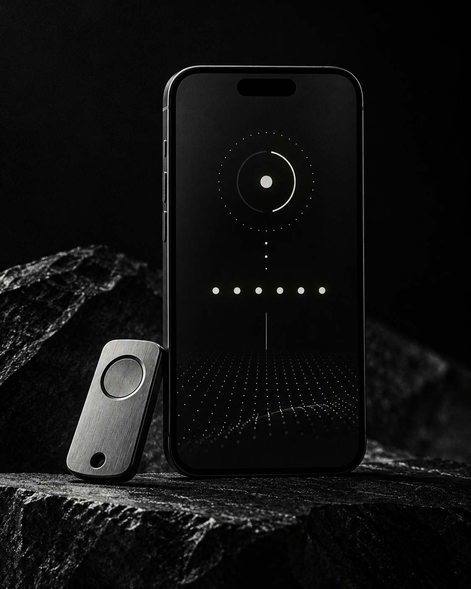

# Carrossel Editorial Cyber

Skill reutilizável para criar carrosséis de Instagram sobre tecnologia, cibersegurança e carreira com visual editorial dark: preto, grafite, off-white, tipografia pesada e conteúdo direto.




## O que ela entrega

- Roteiro de 5 a 8 slides, começando por um gancho e terminando em CTA.
- Direção de arte para formato vertical 4:5 (1080×1350).
- Prompts de imagem com texto, hierarquia e restrições de estilo.
- Legenda com aprendizados aplicáveis e hashtags enxutas.
- Linguagem de segurança responsável: prevenção e contexto, sem instruções para abuso.

## Instalar no Claude.ai

1. Baixe este repositório como ZIP ou clone-o.
2. Compacte **a pasta** `carrossel-editorial-cyber` em um arquivo ZIP. O ZIP precisa preservar essa pasta na raiz.
3. No Claude, abra **Customize → Skills → + Create skill → Upload a skill**.
4. Selecione o ZIP, habilite a skill e comece a pedir seus carrosséis.

Estrutura correta do arquivo de instalação:

```text
carrossel-editorial-cyber.zip
└── carrossel-editorial-cyber/
    ├── SKILL.md
    └── PROMPT-MESTRE.md
```

Não compacte apenas os arquivos internos; o Claude espera a pasta da skill dentro do ZIP.

## Instalar no Claude Code

Copie a pasta da skill para o diretório de skills do projeto ou para a pasta pessoal de skills do Claude Code. Depois, inicie uma nova sessão e confira com `/skills`.

```powershell
# Dentro da pasta clonada deste repositório
Copy-Item -Recurse .\carrossel-editorial-cyber .\.claude\skills\
```

Você também pode enviar o ZIP ao Claude.ai. Skills enviadas pela sua conta podem sincronizar com o Claude Code quando esse recurso estiver habilitado.

## Como usar

Exemplo de pedido:

```text
Crie um carrossel de 7 slides sobre passkeys para profissionais de TI.
Público: analistas de segurança iniciantes.
Tom: jornalístico e direto.
Use preto, branco e cinza; sem neon. Primeiro me entregue o roteiro e espere minha aprovação antes das imagens.
```

Para um briefing mais completo, use [PROMPT-MESTRE.md](carrossel-editorial-cyber/PROMPT-MESTRE.md).

## Estrutura do repositório

```text
.
├── carrossel-editorial-cyber/
│   ├── SKILL.md
│   └── PROMPT-MESTRE.md
└── assets/
    ├── cover.png
    └── example-slide.png
```

## Referências

- [Como criar skills customizadas no Claude](https://support.claude.com/en/articles/12512198-how-to-create-custom-skills)
- [Como usar e enviar skills no Claude](https://support.claude.com/en/articles/12512180-use-skills-in-claude)
